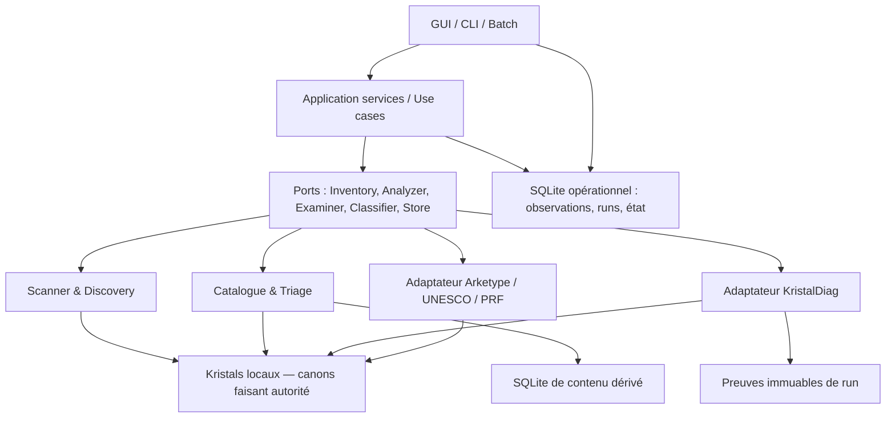

# Architecture cible — monolithe modulaire local

**CIBLE** : un exécutable/application locale, des modules isolés, un catalogue opérationnel persistant et un unique orchestrateur. Pas de microservices, broker, backend Web ou synchronisation continue pour 127 répertoires locaux.

## Modules et responsabilités

1. `domain/` : identités, observations, profil, résultats, machine à états, politiques de fraîcheur — pur Python, sans Tk ni SQL.
2. `application/` : commandes `scan`, `analyze`, `diagnose`, `import`, `export`, `propose_classification`, `approve`; orchestration, transactions et autorisations.
3. `adapters/inventory/` : découverte de workspace, état, fichiers source.
4. `adapters/catalog/` : contenu KQ/KP et indexation, sans revendiquer autorité.
5. `adapters/diagnostics/` : bridge subprocess vers KristalDiag indépendant, puis normalisation de résultats.
6. `adapters/classification/` : Arketype, PRF, UNESCO, règles et sources candidates.
7. `adapters/persistence/` : projection SQLite et migration, interfaces de recherche.
8. `presentation/gui/`, `presentation/cli/` : visualisation et commandes; aucune logique métier cachée.

## Règle de dépendance

`presentation → application → domain`; les adaptateurs implémentent des ports définis côté application/domain; **aucune dépendance Tk/SQL dans le domaine**. Les imports du moteur KristalDiag ne franchissent pas le port d'examen; l'exécution se fait dans un processus isolé.

## Principes d'exploitation

Single process pour Manager, subprocess contrôlé pour Diag, SQLite local, WAL si environnement compatible et migration safe. Les sorties sont hors `locals` et peuvent être reconstruites. Une panne du catalogue ne détruit ni les Kristals ni les preuves de diagnostic.

Voir [frontières](frontieres-et-ports.md), [modèle central](../04-donnees/stockage-sqlite.md), [séquences](sequences-et-cas-limites.md) et [ADR 0001](../11-decisions/0001-monolithe-modulaire.md).
