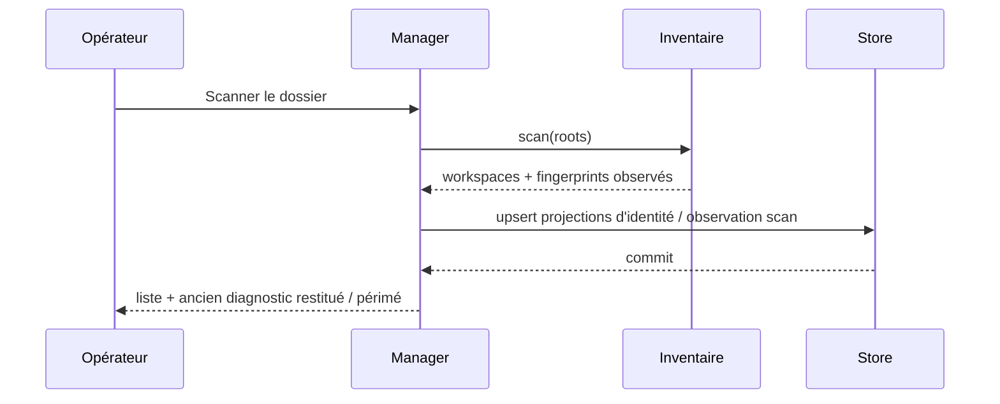
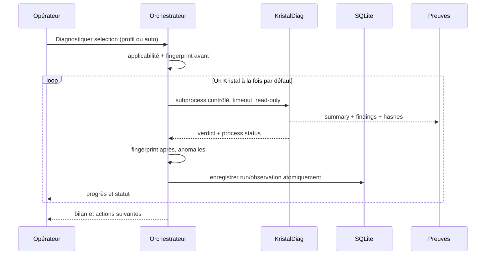

# Séquences de traitement et cas limites

## Inventaire

Un scan n'exécute **ni KristalDiag, ni publication, ni réparation de métadonnées**.

## Diagnostic en lot

## États limites à couvrir

1. **Fichier changé pendant le diagnostic** : conserver le rapport, marquer `SOURCE_CHANGED`/`STALE_OR_UNVERIFIED`, ne pas exposer `PASS CURRENT`.
2. **Panne de SQLite après run réussi** : préserver le rapport sur disque, enregistrer une erreur d'indexation et proposer une réimportation idempotente.
3. **Moteur absent** : verdict métier inconnu et statut de processus `ENGINE_MISSING`, sans supposer `FAIL` du Kristal.
4. **Contrat natif sans V9** : `NOT_APPLICABLE` pour V9, planifier un moteur adapté, ne jamais fabriquer `.kristal/v9` pour satisfaire le test.
5. **Deux scans simultanés** : sérialiser par `scan_root` ou permettre deux générations immuables sans collision.
6. **Relance même rapport** : aucune observation dupliquée; run distinct légitime si date/preuves changent.
7. **Annulation** : terminer correctement le processus enfant; conserver sous statut `CANCELLED` et reprendre les cibles inachevées.
8. **Ancienne base non migrable** : basculer en lecture seule et offrir sauvegarde/export, ne pas détruire le fichier.

Les capacités de reprise/annulation sont **CIBLE**; la livraison antérieure parcourt les 127 de façon séquentielle mais ne fournit pas encore ce protocole complet.
